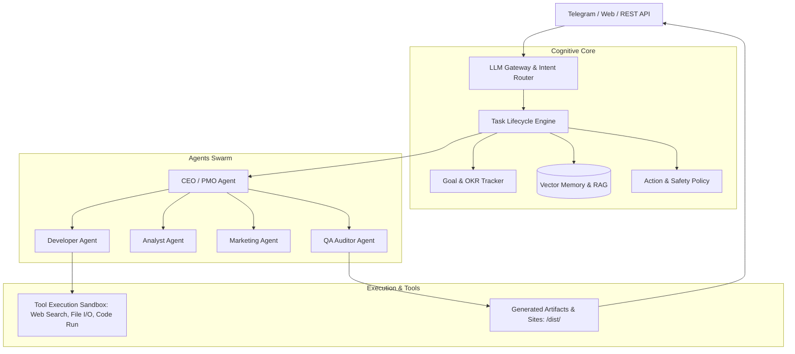

# 🏢 AI Office — Личный автономный виртуальный офис ИИ-сотрудников

**AI Office** — распределенная агентная платформа на базе FastAPI, объединяющая команду из 7 специализированных автономных ИИ-сотрудников. Система управляется через Telegram, Web UI или REST API, решая сквозные задачи бизнеса: от генерации маркетинговых воронок и анализа конкурентов до написания кода, создания рабочих прототипов и ведения финансового учета.

---

## 📌 Штат виртуального офиса (7 ИИ-сотрудников)

1. **CEO / PMO Agent**:
   - Декомпозиция входящих целей бизнеса на спринты и эпики.
   - Назначение исполнителей, контроль дедлайнов и согласование промежуточных фаз.
2. **Product Manager (PM)**:
   - Анализ пользовательских сценариев, формулирование Customer Journey Map (CJM) и составление детальных ТЗ.
3. **Developer (Fullstack Engineer)**:
   - Генерация готового кода, прототипов сайтов, скриптов автоматизации, верстка в HTML/JS/CSS.
4. **Data & Market Analyst**:
   - Сбор открытых данных, анализ рыночных ниш, юнит-экономики и расчет CAC/LTV.
5. **Copywriter & Marketer**:
   - Разработка контент-планов, создание рекламных креативов, SEO-статей и рассылок.
6. **QA / Reviewer Agent**:
   - Автоматическая проверка сгенерированных текстов и кода на соответствие ТЗ, синтаксис и галлюцинации.
7. **Ops & Support Agent**:
   - Подготовка клиентских скриптов ответов, ведение документации и отслеживание операционных расходов токенов.

---

## 🏗 Архитектура и сквозной Data Flow



---

## 🛠 Технические характеристики и стек

| Слой | Стек | Описание |
|---|---|---|
| **Бэкенд Сервер** | Python 3.11+, FastAPI, Uvicorn | Высокоскоростной асинхронный REST API |
| **LLM Модели** | OpenAI GPT-4o / Claude 3.5 Sonnet / Gemini Pro | Мультимодельная маршрутизация (`llm_router.py`) |
| **Память и RAG** | Векторные эмбеддинги, Семантический поиск | Персистентный контекст диалогов и корпоративная база знаний |
| **Управление задачами** | `task_lifecycle.py`, Event Bus (`agent_events.py`) | FSM управления жизненным циклом бизнес-задач |
| **Управление пакетами** | `uv`, `pyproject.toml`, `requirements.txt` | Мгновенный детерминированный резолв зависимостей |
| **Деплой** | `render.yaml` (Render Cloud), Docker | Конфигурация облачного хостинга |

---

## 📁 Структура каталогов

```text
ai-office/
├── core/
│   ├── action_policy.py    # Политики допустимых действий и ограничений агентов
│   ├── agent_events.py     # Шина событий агентов (Event-driven архитектура)
│   ├── agent_profiles.py   # Промпты, роли, экспертиза и системные инструкции 7 агентов
│   ├── auth.py             # Аутентификация запросов и безопасность сессий
│   ├── chat_history.py     # Сессионное хранение переписки и цепочек рассуждений
│   ├── db.py & models.py   # Модели базы данных задач, целей и агентов
│   ├── llm_router.py       # Маршрутизатор запросов между OpenAI, Anthropic и локальными моделями
│   ├── task_lifecycle.py   # Контроллер переходов статусов задач (New -> In Progress -> Done)
│   └── state.py            # Централизованный стейт офиса
├── memory/                 # Модули RAG, эмбеддинги и персистентное векторное хранилище
├── tools/                  # Инструменты агентов: поиск в DuckDuckGo/Google, парсинг, запуск bash
├── evals/                  # Бенчмарки и юнит-тесты качества решений агентов
├── config/                 # Конфигурационные файлы окружения
├── dist/                   # Выходные файлы, сгенерированные сайты и презентации
├── office.py               # Основной сервис FastAPI приложения
├── run.py                  # CLI точка входа
├── AI_Office_business_case.md # Анализ бизнес-кейса, окупаемости и юнит-экономики
└── P1_DELIVERY_REPORT.md   # Формальный отчет сдачи этапа MVP P1
```

---

## ⚙️ Переменные окружения (`.env`)

```ini
# Ключи провайдеров искусственного интеллекта
OPENAI_API_KEY=sk-...
ANTHROPIC_API_KEY=sk-ant-...

# Интеграция с Telegram
TELEGRAM_BOT_TOKEN=...
TELEGRAM_ADMIN_CHAT_ID=...

# Конфигурация сервера
PORT=8000
HOST=0.0.0.0
ENVIRONMENT=production
VECTOR_STORE_PATH=./memory/vector_db
```

---

## 🚀 Команды запуска и разработки

```bash
cd ai-office

# 1. Активация виртуального окружения через uv
uv venv
source .venv/bin/activate
uv pip install -r requirements.txt

# 2. Локальный запуск сервера
python run.py

# 3. Запуск тестов качества и эвалов
pytest evals/
```
